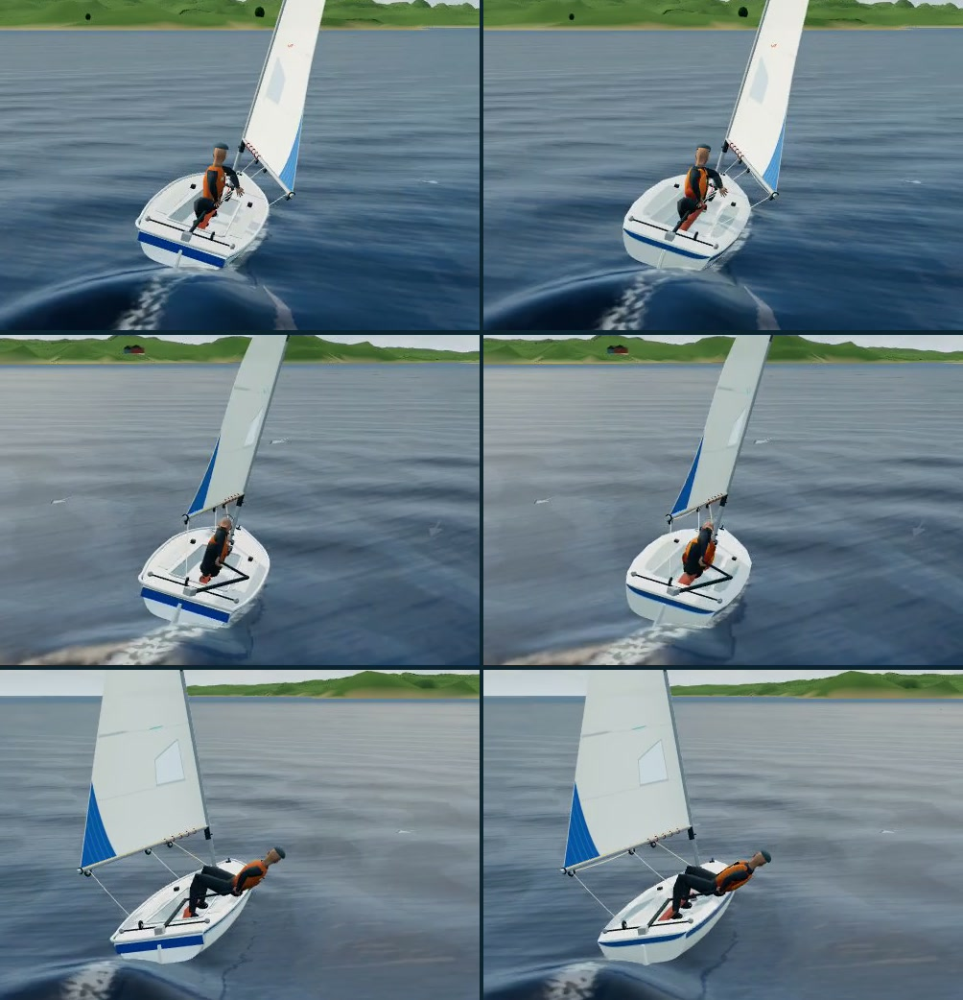

# Laserjollen som visuel reference for TACK

**Spil lokalt på [localhost:5177](http://localhost:5177/).** Før-build `9c0e490548f0` og efter-build `db4d91cd2700`. Browseren kontrollerede buildnummeret i dokumentet mod versionen i HTTP-svaret.

- [Før og efter · stagvending til styrbord](til-styrbord.mp4)
- [Før og efter · stagvending til bagbord](til-bagbord.mp4)
- [Blender-scene](laser.blend) · [GLB-eksport](laser.glb) · [Generator](../../scripts/prepare-laser.py)



## Det aktive billede

| Del | I spillet |
| --- | --- |
| Renderer | Lokal Three.js r160 med sRGB-output, ACES-tonemapping og vejrafhængig eksponering. Grafikkvalitet styrer blandt andet opløsning, vanddetaljer, skygger og detaljer på fjerne både. |
| Lys og teksturer | Sol og halvkuglelys med lokale Poly Haven-panoramaer for klar og overskyet himmel. Farveteksturer bruger sRGB, og normalkortet fra Denim Fabric bruges som lineære data. Sejlcanvas genereres i spillet. [Grafikressourcer og licenser](../../ASSETS.md) |
| Laser før | Skrog, cockpit, beslag og redningsvest blev bygget af kode i browseren. |
| Laser efter | Et Blender-GLB giver skrog, cockpit, dækbeslag og redningsvest. Fordæk, skrogbånd og cockpit har hver deres finish. Bådens model følger de geometriske stationer, som opdriften bruger. Skroget måler 4,23 × 1,37 m, og modelprofilen bruger 7,06 m² sejl. De officielle måletegninger og spilprofilen er grundlaget for fortolkningen af formen. [ILCA’s håndbog](https://ilcasailing.org/laserinternational/wp-content/uploads/2025/02/HANDBOOK-2025.pdf) · [ILCA’s måletegninger](https://ilcasailing.org/rules-and-technical/measurement-diagrams/) |
| Sejler | MakeHuman-hoved og greb samt TACKs eksisterende skelet med 14 knogler. Tre interpolerede stillinger og et særskilt forløb for skuldre, hoved og fødder følger den beregnede bevægelse på tværs. Sejleren reagerer med overkroppen, når stævnen rammer vandet. Animationen beregnes af de aktuelle spildata. |
| Rig og vand | Bommens aktuelle stilling flytter blokkene og skødets vej frem til hånden. Gelcoat og skrogbånd bruger den lokale vandflade til dæmpning og glans. Kølvandet starter ved den våde hæk, bliver i verden og følger den sejlede rute. |
| Reservegrafik | Den gamle kodegenererede Laser er tilgængelig ved manglende eller ugyldig GLB. På laveste detaljeniveau bruger figuren den enklere vest. De almindelige afstandsmodeller bruges fortsat for fjerne både. |

Originalt skrog, cockpit og redningsvest er lavet til TACK. Den aktive GLB hentes lokalt og er indlejret i én versioneret fil i udgivelsen. [Grafikressourcer og licenser](../../ASSETS.md)

Skrog, beslag og vest kan justeres i Blender. Sejlets form, greb, fysiske drejepunkter og vandkontakt bliver fortsat beregnet i spillet, så modellen følger det, spilleren gør.

## Prøve i Fri sejlads

To stagvendinger på Svær med følgekameravinklen, 7,5 m/s fra nord, 0,35 m bølger og 16 % chop. Begge klip bruger 1280 × 800, samme starttilstand, lys og vind-/bølgeseed. Tasterne styrer ror, vægt og side, og skødet betjenes via spillets skyder. Stagvendingen afsluttes med kant og fuldt hæng på den nye hals.

| Forløb | Fart før vending | Laveste fart | Fart efter |
| --- | ---: | ---: | ---: |
| Til styrbord | 5,58 kn | 3,98 kn | 6,70 kn |
| Til bagbord | 5,62 kn | 4,10 kn | 6,91 kn |

De optagede positioner, rotationer, hastigheder, sejlkræfter og vandkontakter stemte præcist mellem før og efter og mellem Lav og Høj grafik. Enderne på skøde og rorpindsforlænger sad ved håndens greb inden for beregningens afrunding. Fødderne fulgte støttepunkterne i samme interpolerede simulationstilstand. Kasketten havde mindst 13 cm fri afstand til bommens forenklede prøvevolumen i de to vendinger. Resultatet gælder de prøvede forløb og den målte geometri. [Data til styrbord](til-styrbord.json.gz) · [Data til bagbord](til-bagbord.json.gz)

`npm test` bestod med 67 tests. Typekontrollen for simulationen bestod. Alle 17 browserprøver i render- og vandpakken bestod. En separat prøve bekræftede skift mellem alle fem bådtyper og deres skeletter. Prøverne dækkede blandt andet reservegrafik, skrivebeskyttet fysiktilstand, Laserens nye geometri, vand i cockpittet, sprøjt ved stævnslag og kølvand ved begge våde hækhjørner.

## Billedtid

Mac med Apple M5, 32 GB, macOS 26.3 og Chrome 158.0.8127.37. Én Laser i Fri sejlads med følgekameravinklen. For hver kombination er der kørt fire målinger i rækkefølgen før, efter, efter, før. Efter opvarmning måles intervallet mellem tegnede billeder i fire sekunder med ror- og skødeinput. Tabellen viser medianen af de to gennemløb pr. build. Browserens visningsområde var 1280 × 800.

| Grafik | Renderopløsning | Median før → efter | P95 før → efter | Tegnekald før → efter |
| --- | --- | --- | --- | --- |
| Høj | 1280 × 800 | 16,7 → 16,7 ms | 18,2 → 18,5 ms | 164 → 161 |
| Lav | 789 × 493 | 16,7 → 16,7 ms | 18,7 → 18,2 ms | 160 → 156 |
| Lav · CPU droslet 4× | 789 × 493 | 16,7 → 16,7 ms | 18,2 → 18,3 ms | 160 → 155 |

Chrome rapporterede 118 kB overført for den nye model i en frisk kontekst. De hardwareaccelererede prøver kørte omtrent 60 billeder i sekundet. Softwaregrafik med SwiftShader gav for få tegnede billeder til en holdbar sammenligning. En fysisk svag målcomputer er stadig nødvendig for at vurdere oplevelsen dér. [Målinger med Metal](billedtid.json) · [Droslet CPU](billedtid-cpu4x.json) · [Målinger med SwiftShader](billedtid-software.json)

## Reproduktion

```sh
blender -b -t 2 --python-exit-code 1 --python scripts/prepare-laser.py -- /tmp/tack-laser.blend
npm run build
TACK_LASER_TRIAL=art node scripts/laser-session.cjs FØR_URL EFTER_URL gennemgang/laser-model
node scripts/laser-session.cjs FØR_URL EFTER_URL gennemgang/laser-model --timing
node scripts/laser-session.cjs FØR_URL EFTER_URL gennemgang/laser-model --timing --software
node scripts/laser-session.cjs FØR_URL EFTER_URL gennemgang/laser-model --timing --cpu4x
```
